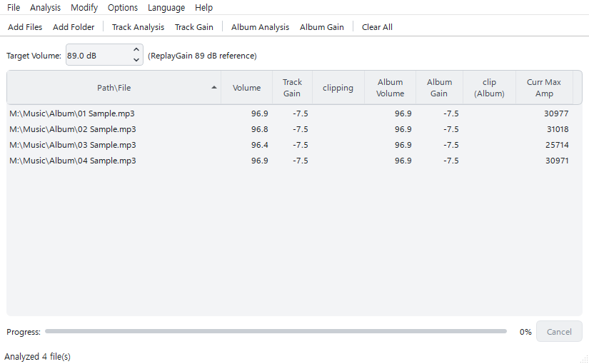
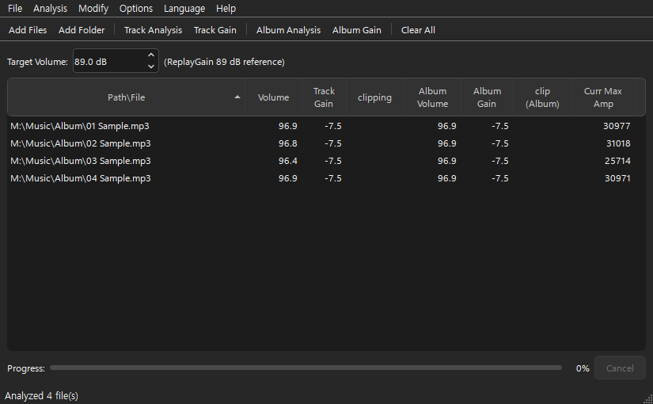

<p align="center">
  <strong>Language:</strong>
  <a href="README.md">English</a> |
  <a href="README.ko.md">한국어</a> |
  <a href="README.zh-CN.md">简体中文</a> |
  <a href="README.ja.md">日本語</a> |
  <a href="README.es.md">Español</a> |
  <a href="README.ru.md">Русский</a>
</p>

> Este documento es una traducción automática con IA de la versión en inglés. Si hay diferencias, prevalece la versión en inglés.

# Gain dB

<p align="center">
  <a href="https://github.com/metapbl/GainDB/releases"></a>
  <a href="LICENSE"></a>
  <a href="#requisitos"></a>
  <a href="#instalación"></a>
</p>

Analiza e iguala el volumen de archivos MP3 sin volver a codificarlos, desde la línea de comandos o una GUI.

## Qué hace

Gain dB mide lo fuerte que suenan tus archivos MP3 y los iguala **sin volver a
codificarlos**, así que no se pierde calidad. Es una refactorización en Python
hecha a partir de la lectura del código fuente de mp3gain y da los mismos
resultados que mp3gain: los mismos valores en dB, pasos de ganancia y etiquetas.

- **Cambio de ganancia sin pérdidas.** Cada trama MP3 tiene un campo
  `global_gain` de 8 bits. Cambiarlo N pasos escala el sonido por `2^(N/4)`
  (unos 1,5 dB por paso) sin tocar los datos de audio, y el cambio se puede
  deshacer.
- **Análisis de sonoridad.** El audio se decodifica con ffmpeg y se mide con el
  algoritmo ReplayGain para calcular el cambio necesario para llegar a una
  sonoridad objetivo (89 dB por defecto).
- **Modos Track y Album.** La ganancia Track iguala cada archivo. La ganancia
  Album aplica un mismo cambio a todos los archivos, de modo que se mantienen las
  diferencias de sonoridad entre pistas.
- **Etiquetas.** Lee, escribe y elimina etiquetas ReplayGain y mp3gain en APEv2
  (por defecto) o ID3v2, incluida la información para deshacer.
- **CLI y GUI.** Una herramienta de línea de comandos con las opciones de
  mp3gain y una GUI con PySide6 para Windows y macOS, con temas oscuro y claro,
  seis idiomas (English, 한국어, 简体中文, 日本語, Español, Русский) y las
  opciones de la GUI original de mp3gain.

Gain dB trabaja **solo con archivos MP3**, por diseño: la técnica sin pérdidas
depende del campo `global_gain` de MP3, que otros formatos no tienen.

## Capturas de pantalla

<table>
  <tr>
    <th>Claro</th>
    <th>Oscuro</th>
  </tr>
  <tr>
    <td></td>
    <td></td>
  </tr>
</table>

Análisis de álbum de cuatro archivos de ejemplo: el volumen de cada archivo y la ganancia Track/Album.

## Requisitos

- **ffmpeg y ffprobe** — necesarios para el análisis. No se incluyen; instálalos
  tú mismo (ver abajo).
- **Para ejecutar desde el código fuente:** Python 3.13 o posterior. Los paquetes
  (numpy, PySide6) se instalan desde `requirements.txt`.

### Instalar ffmpeg

Descarga una compilación para tu sistema y asegúrate de que `ffmpeg` y
`ffprobe` estén en tu PATH:

- **Windows:** `winget install Gyan.FFmpeg`, o la compilación "release
  essentials" de https://www.gyan.dev/ffmpeg/builds/
- **macOS:** `brew install ffmpeg`, o una compilación de https://evermeet.cx/ffmpeg/
- **Linux:** tu gestor de paquetes (por ejemplo `sudo apt install ffmpeg`), o
  una compilación estática de https://johnvansickle.com/ffmpeg/

Gain dB busca primero en tu PATH. Si no los encuentra, revisa también estas
carpetas en orden y solo usa una carpeta si contiene ambos programas:

- **Windows:** `%LOCALAPPDATA%\Microsoft\WinGet\Links` (winget),
  `C:\ffmpeg\bin`, `%ProgramFiles%\ffmpeg\bin`
- **macOS:** `/opt/homebrew/bin`, `/usr/local/bin` (Homebrew; cubre las apps
  abiertas desde Finder, que no ven el PATH de tu shell)

## Instalación

**Aplicación para Windows:** descarga `GainDB-<versión>-windows.zip` desde
[Releases](https://github.com/metapbl/GainDB/releases), descomprímelo y ejecuta
`GainDB.exe` en la carpeta `GainDB`. No hace falta Python.

**Desde el código fuente (Windows, macOS, Linux):**

```
git clone https://github.com/metapbl/GainDB.git
cd GainDB
python -m venv .venv
.venv\Scripts\activate          # macOS / Linux: source .venv/bin/activate
pip install -r requirements.txt
```

Esto crea un entorno virtual en `.venv` e instala en él los paquetes.

## Inicio rápido

Abre la GUI (desde el código fuente: `python -m gui`), añade archivos o una
carpeta y elige **Análisis > Análisis de álbum** y luego **Modificar > Ganancia
de álbum**. El análisis rellena las columnas de dB; el paso de ganancia
modifica los archivos y guarda etiquetas para deshacer.

En la línea de comandos, solo analizar no modifica el archivo:

```
python gaindb_cli.py song.mp3
```

```
song.mp3
Recommended "Track" dB change: -7.880000
Recommended "Track" mp3 gain change: -5
Max PCM sample at current gain: 30976.785156
Max mp3 global gain field: 210
Min mp3 global gain field: 158
```

Los números dependen de tu archivo. Un cambio de ganancia de `-5` significa que
el archivo bajaría 5 pasos (unos 7,5 dB).

## Uso

### Línea de comandos

```
python gaindb_cli.py [options] <infile> [<infile 2> ...]
```

Opciones habituales (las mismas que mp3gain):

- `-r` aplica la ganancia Track para que todos los archivos tengan la misma sonoridad
- `-a` aplica una única ganancia Album común a todos los archivos
- `-k` baja la ganancia Track/Album lo necesario para evitar el recorte (clipping)
- `-s c` solo muestra la información guardada en las etiquetas
- `-s d` solo borra la información guardada en las etiquetas
- `-s i` guarda la información de ganancia en una etiqueta ID3v2 (APEv2 es la predeterminada)
- `-u` deshace los cambios anteriores usando la información de las etiquetas
- `-o` imprime una lista separada por tabulaciones, cómoda para bases de datos

`python gaindb_cli.py -h` muestra todas las opciones y
`python gaindb_cli.py -? wrap` explica la opción `-w` (wrap).

```
# Apply Track gain to one file
python gaindb_cli.py -r song.mp3

# Apply Album gain to a folder's files, avoiding clipping
python gaindb_cli.py -a -k album/*.mp3

# Undo previous changes
python gaindb_cli.py -u song.mp3
```

Cada comando muestra lo que cambió, archivo por archivo. Si no estás seguro,
haz una copia de tus archivos antes de la primera ejecución.

### Interfaz gráfica

```
python -m gui
```

Esto abre la ventana principal. Tiene listas de archivos y carpetas, análisis y
ganancia Track/Album, un menú contextual, cancelación, una ventana de registro
y un icono en la bandeja. El menú Idioma y Opciones > Tema cambian la pantalla
al instante. El menú Opciones permite conservar la fecha de los archivos, evitar
el recorte en la ganancia Track y recalcular siempre en lugar de leer las
etiquetas guardadas. Modificar > Aplicar ganancia constante cambia los archivos
un número fijo de pasos, y Opciones > Activar las funciones de "maximización"
añade el análisis y la ganancia máximos sin saturación de la GUI original de
mp3gain. El menú Archivo puede seleccionar todos los archivos, ninguno o invertir
la selección, e Idioma > Predeterminado del sistema sigue el idioma del sistema
operativo.

## Relación con mp3gain

Gain dB es una refactorización en Python del código fuente de mp3gain. Mantiene
el comportamiento, las opciones de línea de comandos y los formatos de archivo
y de etiquetas de mp3gain para que los resultados sean compatibles. Los módulos
de etiquetas y de escritura de ganancia sin pérdidas están adaptados del código
fuente en C de mp3gain, que tiene licencia GNU LGPL v2.1 o posterior, y Gain dB
en su conjunto usa la misma licencia. El análisis de sonoridad sigue la
especificación pública de ReplayGain; sus coeficientes de filtro son valores
estándar compartidos por implementaciones independientes. Consulta
[NOTICE](NOTICE) para más detalles.

## Estado del proyecto

- Versión 1.x, en uso habitual. Las opciones de línea de comandos siguen a
  mp3gain y no se espera que cambien.
- Cada push ejecuta las pruebas en Windows, macOS y Ubuntu. En macOS y Ubuntu
  también compara los valores en dB, los pasos de ganancia y las etiquetas con
  mp3gain.
- La GUI se comprueba en Windows y en un runner de macOS. Las versiones
  compiladas son solo para Windows; en macOS y Linux, ejecútalo desde el código
  fuente. La GUI no se ha probado en Linux.

## Ayuda y contribuciones

- Preguntas e informes de errores: [GitHub Issues](https://github.com/metapbl/GainDB/issues).
- Los pull requests son bienvenidos. Para cambios grandes, abre antes un issue
  para hablarlo. Las contribuciones se aceptan bajo LGPL-2.1-or-later.
- Antes de enviar un pull request, ejecuta todas las pruebas (necesitan ffmpeg):

```
pip install -r requirements-dev.txt
python tests/_gen_fixtures.py
python -m unittest discover -s tests
```

El primer comando instala los paquetes de prueba (añade SciPy); el segundo crea
archivos MP3 de prueba; el tercero ejecuta todas las pruebas.

## Seguridad

Informa de las vulnerabilidades de forma privada mediante el
[informe privado de vulnerabilidades de GitHub](https://github.com/metapbl/GainDB/security/advisories/new),
no en un issue público.

## Créditos

Gain dB se basa en [mp3gain](https://sourceforge.net/projects/mp3gain/) de Glen
Sawyer, con el análisis ReplayGain de David Robinson y Glen Sawyer y mejoras de
Frank Klemm y Marcel Mueller. Usa [numpy](https://numpy.org/),
[PySide6](https://doc.qt.io/qtforpython-6/) y, como
programa externo, [ffmpeg](https://ffmpeg.org/).

## Licencia

[LGPL-2.1-or-later](LICENSE). Consulta [NOTICE](NOTICE) para los avisos de
copyright de mp3gain y [THIRD_PARTY_LICENSES](THIRD_PARTY_LICENSES) para las
dependencias. numpy es BSD-3-Clause; PySide6 (Qt for Python) es LGPLv3.
ffmpeg no se incluye; si distribuyes una compilación de ffmpeg junto con este
software, usa una compilación LGPL y respeta sus términos de licencia.
