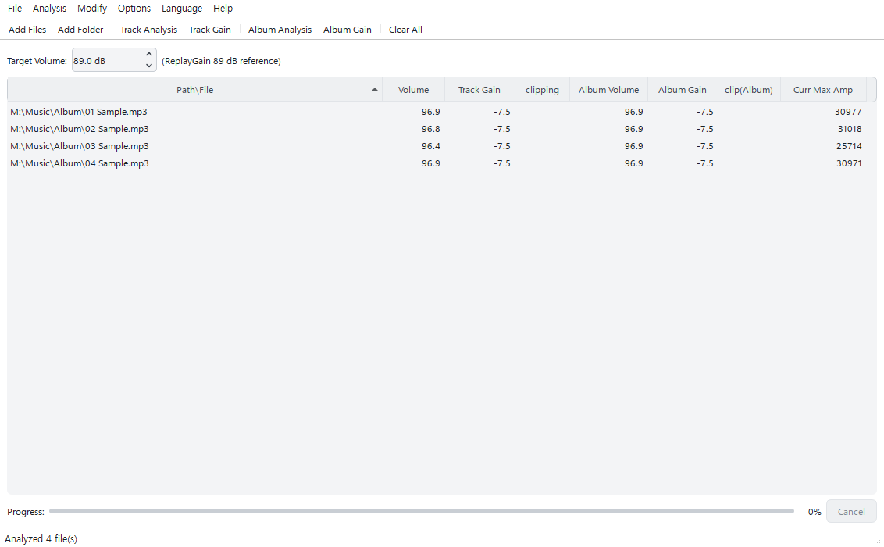
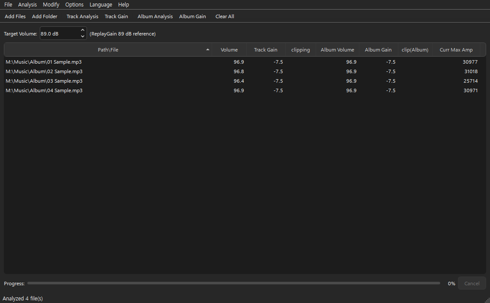

<p align="center">
  <strong>Language:</strong>
  <a href="README.md">English</a> |
  <a href="README.ko.md">한국어</a> |
  <a href="README.zh-CN.md">简体中文</a> |
  <a href="README.ja.md">日本語</a> |
  <a href="README.es.md">Español</a> |
  <a href="README.ru.md">Русский</a>
</p>

> この文書は英語版を AI で翻訳したものです。内容が異なる場合は英語版に従ってください。

# Gain dB

<p align="center">
  <a href="https://github.com/metapbl/GainDB/releases"></a>
  <a href="LICENSE"></a>
  <a href="#動作要件"></a>
  <a href="#インストール"></a>
</p>

MP3 の音量を再エンコードせずに解析してそろえる、CLI・GUI ツールです。

## 機能

Gain dB は MP3 ファイルがどれくらい大きく聞こえるかを測り、**再エンコードせずに**
音量をそろえます。そのため音質は劣化しません。mp3gain のソースを読んで Python で
リファクタリングしたもので、mp3gain と同じ結果（dB 値・ゲインステップ・タグ）を
出します。

- **無劣化のゲイン変更。** MP3 の各フレームには 8 ビットの `global_gain`
  フィールドがあります。これを N ステップ変えると音が `2^(N/4)` 倍
  （1 ステップ約 1.5 dB）になり、音声データには触れず、元に戻せます。
- **ラウドネス解析。** ffmpeg でデコードした音声を ReplayGain アルゴリズムで
  測定し、目標の音量（既定 89 dB）に合わせるのに必要な変更量を求めます。
- **Track と Album モード。** Track ゲインはファイルごとに音量をそろえます。
  Album ゲインはすべてのファイルに同じ変更を適用し、曲間の音量差を保ちます。
- **タグ。** APEv2（既定）または ID3v2 の ReplayGain・mp3gain タグを読み書き・
  削除し、元に戻すための情報も保存します。
- **CLI と GUI。** mp3gain のオプションを使うコマンドラインツールと、Windows・
  macOS 用の PySide6 GUI。GUI はダーク・ライトテーマ、6 言語（English、한국어、
  简体中文、日本語、Español、Русский）、元の mp3gain GUI のオプションに対応します。

Gain dB は設計上 **MP3 ファイルのみ** を扱います。無劣化の方式は MP3 の
`global_gain` フィールドに依存しており、ほかの形式にはこのフィールドがありません。

## スクリーンショット

<table>
  <tr>
    <th>ライト</th>
    <th>ダーク</th>
  </tr>
  <tr>
    <td></td>
    <td></td>
  </tr>
</table>

サンプルファイル 4 件をアルバム解析した画面です。ファイルごとの音量と Track/Album ゲインが表示されます。

## 動作要件

- **ffmpeg と ffprobe** — 解析に必要です。同梱していないので、各自で
  インストールしてください（下記参照）。
- **ソースから実行する場合：** Python 3.13 以上。パッケージ（numpy、scipy、
  PySide6）は `requirements.txt` でインストールします。

### ffmpeg のインストール

お使いのシステム用のビルドを入手し、`ffmpeg` と `ffprobe` の両方が PATH に
あるようにしてください。

- **Windows：** `winget install Gyan.FFmpeg`、または
  https://www.gyan.dev/ffmpeg/builds/ の "release essentials" ビルド
- **macOS：** `brew install ffmpeg`、または https://evermeet.cx/ffmpeg/ のビルド
- **Linux：** パッケージマネージャー（例：`sudo apt install ffmpeg`）、または
  https://johnvansickle.com/ffmpeg/ の静的ビルド

Gain dB はまず PATH を探します。見つからなければ次のフォルダーを順に確認し、
両方のプログラムがそろったフォルダーだけを使います。

- **Windows：** `%LOCALAPPDATA%\Microsoft\WinGet\Links`（winget）、
  `C:\ffmpeg\bin`、`%ProgramFiles%\ffmpeg\bin`
- **macOS：** `/opt/homebrew/bin`、`/usr/local/bin`（Homebrew。Finder から起動
  したアプリはシェルの PATH を参照しないため、その場合も見つけられます）

## インストール

**Windows アプリ：** [Releases](https://github.com/metapbl/GainDB/releases) から
`GainDB-<バージョン>-windows.zip` をダウンロードして展開し、`GainDB` フォルダーの
`GainDB.exe` を実行します。Python は不要です。

**ソースから（Windows、macOS、Linux）：**

```
git clone https://github.com/metapbl/GainDB.git
cd GainDB
python -m venv .venv
.venv\Scripts\activate          # macOS / Linux: source .venv/bin/activate
pip install -r requirements.txt
```

`.venv` に仮想環境を作り、その中にパッケージをインストールします。

## クイックスタート

GUI を開き（ソースからは `python -m gui`）、ファイルかフォルダーを追加して、
**解析 > アルバム解析**、**変更 > アルバムゲイン** の順に選びます。解析で dB の
列が埋まり、ゲインの段階でファイルが変更され、元に戻すためのタグが保存されます。

コマンドラインでは、解析だけならファイルは変わりません。

```
python gaindb_cli.py song.mp3
```

```
song.mp3
Recommended "Track" dB change: -7.880000
Recommended "Track" mp3 gain change: -5
Max PCM sample at current gain: 30976.785156
Max mp3 global gain field: 210
Min mp3 global gain field: 158
```

数値はファイルによって異なります。ゲイン変更 `-5` は、ファイルを 5 ステップ
（約 7.5 dB）下げるという意味です。

## 使い方

### コマンドライン

```
python gaindb_cli.py [options] <infile> [<infile 2> ...]
```

よく使うオプション（mp3gain と同じ）：

- `-r` すべてのファイルが同じ音量になるよう Track ゲインを適用
- `-a` すべてのファイルに共通の Album ゲインを 1 つ適用
- `-k` クリッピングを避けるため必要に応じて Track/Album ゲインを下げる
- `-s c` 保存済みのタグ情報だけを表示
- `-s d` 保存済みのタグ情報だけを削除
- `-s i` ゲイン情報を ID3v2 タグに保存（既定は APEv2）
- `-u` 保存済みのタグ情報を使って以前の変更を元に戻す
- `-o` タブ区切りで、データベースに取り込みやすい一覧を出力

`python gaindb_cli.py -h` ですべてのオプションを表示し、
`python gaindb_cli.py -? wrap` で `-w` wrap オプションを説明します。

```
# Apply Track gain to one file
python gaindb_cli.py -r song.mp3

# Apply Album gain to a folder's files, avoiding clipping
python gaindb_cli.py -a -k album/*.mp3

# Undo previous changes
python gaindb_cli.py -u song.mp3
```

各コマンドは変更内容をファイルごとに出力します。不安なら、初回の実行前に
ファイルをコピーしておいてください。

### グラフィカルインターフェース

```
python -m gui
```

メインウィンドウが開きます。ファイル・フォルダーの一覧、Track/Album の解析と
ゲイン、右クリックメニュー、キャンセル、ログウィンドウ、トレイアイコンがあります。
言語メニューと オプション > テーマ は画面をすぐに切り替えます。オプションメニュー
では、ファイルの日時の保持、Track ゲインでのクリッピング回避、保存済みタグを
読まずに常に再計算することを選べます。

## mp3gain との関係

Gain dB は mp3gain のソースを Python でリファクタリングしたものです。結果の互換性
を保つため、mp3gain の動作、コマンドラインオプション、ファイルとタグの形式を
そのまま引き継いでいます。タグ処理と無劣化ゲイン書き込みのモジュールは、GNU
LGPL v2.1 以降で提供されている mp3gain の C ソースを改変したもので、Gain dB 全体
も同じライセンスを使います。ラウドネス解析は公開されている ReplayGain 仕様に従い、
フィルター係数は複数の独立した実装が共有する公開の標準値です。詳しくは
[NOTICE](NOTICE) を参照してください。

## プロジェクトの状況

- バージョン 1.x で、実際に使われています。コマンドラインオプションは mp3gain に
  従っており、変更の予定はありません。
- push のたびに Windows・macOS・Ubuntu でテストを実行します。macOS と Ubuntu では
  dB 値・ゲインステップ・タグを mp3gain と照合します。
- GUI は Windows と macOS のランナーで確認しています。リリースビルドは Windows
  用のみで、macOS と Linux ではソースから実行します。Linux での GUI は未検証です。

## ヘルプと貢献

- 質問とバグ報告：[GitHub Issues](https://github.com/metapbl/GainDB/issues)。
- Pull request を歓迎します。大きな変更は先に issue を開いて相談してください。
  貢献は LGPL-2.1-or-later で受け付けます。
- Pull request を送る前に、すべてのテストを実行してください（ffmpeg が必要）。

```
python tests/_gen_fixtures.py
python -m unittest discover -s tests
```

1 つ目のコマンドはテスト用の MP3 ファイルを作り、2 つ目はすべてのテストを実行します。

## セキュリティ

脆弱性は公開の issue ではなく、
[GitHub の非公開脆弱性報告](https://github.com/metapbl/GainDB/security/advisories/new)
で知らせてください。

## クレジット

Gain dB は Glen Sawyer による [mp3gain](https://sourceforge.net/projects/mp3gain/)
をもとにしています。ReplayGain 解析は David Robinson と Glen Sawyer によるもので、
Frank Klemm と Marcel Mueller が改良しました。[numpy](https://numpy.org/)、
[SciPy](https://scipy.org/)、[PySide6](https://doc.qt.io/qtforpython-6/) を使い、
外部プログラムとして [ffmpeg](https://ffmpeg.org/) を呼び出します。

## ライセンス

[LGPL-2.1-or-later](LICENSE)。mp3gain の著作権表示は [NOTICE](NOTICE) に、依存
関係のライセンスは [THIRD_PARTY_LICENSES](THIRD_PARTY_LICENSES) にあります。
numpy と SciPy は BSD-3-Clause、PySide6（Qt for Python）は LGPLv3 です。ffmpeg は
同梱していません。本ソフトウェアと一緒に ffmpeg のビルドを配布する場合は、LGPL
ビルドを使い、そのライセンス条件に従ってください。
