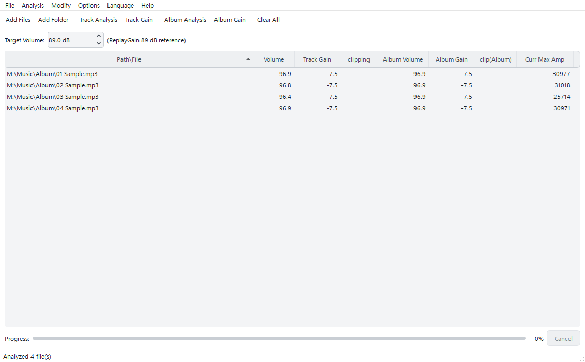
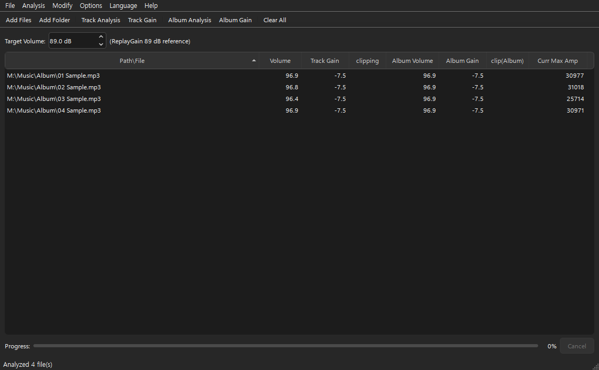

<p align="center">
  <strong>Language:</strong>
  <a href="README.md">English</a> |
  <a href="README.ko.md">한국어</a> |
  <a href="README.zh-CN.md">简体中文</a> |
  <a href="README.ja.md">日本語</a> |
  <a href="README.es.md">Español</a> |
  <a href="README.ru.md">Русский</a>
</p>

> Этот документ переведён с английской версии с помощью ИИ. При расхождениях ориентируйтесь на английскую версию.

# Gain dB

<p align="center">
  <a href="https://github.com/metapbl/GainDB/releases"></a>
  <a href="LICENSE"></a>
  <a href="#требования"></a>
  <a href="#установка"></a>
</p>

Анализ и выравнивание громкости MP3 без перекодирования — из командной строки или в GUI.

## Возможности

Gain dB измеряет, насколько громко звучат ваши MP3-файлы, и выравнивает их
**без перекодирования**, поэтому качество не теряется. Это рефакторинг на Python,
сделанный по исходному коду mp3gain, и он даёт те же результаты, что и mp3gain:
те же значения в дБ, шаги усиления и теги.

- **Изменение усиления без потерь.** В каждом кадре MP3 есть 8-битное поле
  `global_gain`. Изменение на N шагов масштабирует звук в `2^(N/4)` раз
  (около 1,5 дБ на шаг), не затрагивая аудиоданные, и его можно отменить.
- **Анализ громкости.** Звук декодируется с помощью ffmpeg и измеряется
  алгоритмом ReplayGain, чтобы найти изменение, нужное для целевой громкости
  (по умолчанию 89 дБ).
- **Режимы Track и Album.** Усиление Track выравнивает каждый файл. Усиление
  Album применяет одно общее изменение ко всем файлам, сохраняя разницу
  громкости между треками.
- **Теги.** Читает, записывает и удаляет теги ReplayGain и mp3gain в APEv2
  (по умолчанию) или ID3v2, включая данные для отмены.
- **CLI и GUI.** Инструмент командной строки с параметрами mp3gain и GUI на
  PySide6 для Windows и macOS: тёмная и светлая темы, шесть языков (English,
  한국어, 简体中文, 日本語, Español, Русский) и параметры оригинального GUI mp3gain.

Gain dB по замыслу работает **только с файлами MP3**: метод без потерь
опирается на поле `global_gain` формата MP3, которого нет в других форматах.

## Скриншоты

<table>
  <tr>
    <th>Светлая</th>
    <th>Тёмная</th>
  </tr>
  <tr>
    <td></td>
    <td></td>
  </tr>
</table>

Анализ альбома из четырёх демонстрационных файлов: громкость каждого файла и усиление Track/Album.

## Требования

- **ffmpeg и ffprobe** — нужны для анализа. Они не входят в комплект;
  установите их сами (см. ниже).
- **Для запуска из исходного кода:** Python 3.13 или новее. Пакеты (numpy,
  scipy, PySide6) устанавливаются из `requirements.txt`.

### Установка ffmpeg

Скачайте сборку для своей системы и убедитесь, что `ffmpeg` и `ffprobe`
находятся в PATH:

- **Windows:** `winget install Gyan.FFmpeg` или сборка "release essentials" с
  https://www.gyan.dev/ffmpeg/builds/
- **macOS:** `brew install ffmpeg` или сборка с https://evermeet.cx/ffmpeg/
- **Linux:** менеджер пакетов (например, `sudo apt install ffmpeg`) или
  статическая сборка с https://johnvansickle.com/ffmpeg/

Сначала Gain dB ищет программы в PATH. Если их там нет, он по очереди
проверяет эти папки и использует папку, только если в ней есть обе программы:

- **Windows:** `%LOCALAPPDATA%\Microsoft\WinGet\Links` (winget),
  `C:\ffmpeg\bin`, `%ProgramFiles%\ffmpeg\bin`
- **macOS:** `/opt/homebrew/bin`, `/usr/local/bin` (Homebrew; это нужно для
  приложений, запущенных из Finder, которые не видят PATH оболочки)

## Установка

**Приложение для Windows:** скачайте `GainDB-<версия>-windows.zip` со страницы
[Releases](https://github.com/metapbl/GainDB/releases), распакуйте и запустите
`GainDB.exe` в папке `GainDB`. Python не нужен.

**Из исходного кода (Windows, macOS, Linux):**

```
git clone https://github.com/metapbl/GainDB.git
cd GainDB
python -m venv .venv
.venv\Scripts\activate          # macOS / Linux: source .venv/bin/activate
pip install -r requirements.txt
```

Эти команды создают виртуальное окружение в `.venv` и устанавливают в него пакеты.

## Быстрый старт

Откройте GUI (из исходного кода: `python -m gui`), добавьте файлы или папку и
выберите **Анализ > Анализ альбома**, затем **Изменить > Усиление альбома**.
Анализ заполняет столбцы дБ; шаг усиления изменяет файлы и сохраняет теги для
отмены.

В командной строке один только анализ файл не изменяет:

```
python gaindb_cli.py song.mp3
```

```
song.mp3
Recommended "Track" dB change: -7.880000
Recommended "Track" mp3 gain change: -5
Max PCM sample at current gain: 30976.785156
Max mp3 global gain field: 210
Min mp3 global gain field: 158
```

Числа зависят от файла. Изменение усиления `-5` означает, что файл станет тише
на 5 шагов (около 7,5 дБ).

## Использование

### Командная строка

```
python gaindb_cli.py [options] <infile> [<infile 2> ...]
```

Основные параметры (те же, что у mp3gain):

- `-r` применить усиление Track, чтобы все файлы звучали одинаково громко
- `-a` применить одно общее усиление Album ко всем файлам
- `-k` при необходимости уменьшить усиление Track/Album, чтобы избежать клиппинга
- `-s c` только показать сохранённые данные тегов
- `-s d` только удалить сохранённые данные тегов
- `-s i` сохранять данные усиления в теге ID3v2 (по умолчанию APEv2)
- `-u` отменить прошлые изменения по сохранённым данным тегов
- `-o` вывести список с разделителями-табуляциями, удобный для баз данных

`python gaindb_cli.py -h` выводит все параметры, а
`python gaindb_cli.py -? wrap` объясняет параметр `-w` (wrap).

```
# Apply Track gain to one file
python gaindb_cli.py -r song.mp3

# Apply Album gain to a folder's files, avoiding clipping
python gaindb_cli.py -a -k album/*.mp3

# Undo previous changes
python gaindb_cli.py -u song.mp3
```

Каждая команда выводит, что она изменила, по каждому файлу. Если не уверены,
перед первым запуском сделайте копию файлов.

### Графический интерфейс

```
python -m gui
```

Откроется главное окно. В нём есть списки файлов и папок, анализ и усиление
Track/Album, контекстное меню, отмена, окно журнала и значок в трее. Меню Язык
и Параметры > Тема сразу меняют интерфейс. В меню Параметры можно сохранять
дату файлов, избегать клиппинга при усилении Track и всегда пересчитывать
вместо чтения сохранённых тегов.

## Связь с mp3gain

Gain dB — рефакторинг исходного кода mp3gain на Python. Он сохраняет поведение,
параметры командной строки, а также форматы файлов и тегов mp3gain, чтобы
результаты были совместимы. Модули работы с тегами и записи усиления без потерь
адаптированы из исходного кода mp3gain на C, распространяемого по лицензии
GNU LGPL v2.1 или более поздней, и Gain dB в целом использует ту же лицензию.
Анализ громкости следует открытой спецификации ReplayGain; коэффициенты
фильтров — это стандартные значения, общие для независимых реализаций.
Подробности в [NOTICE](NOTICE).

## Состояние проекта

- Версия 1.x, используется на практике. Параметры командной строки следуют
  mp3gain и меняться не должны.
- При каждом push тесты запускаются на Windows, macOS и Ubuntu. На macOS и
  Ubuntu значения в дБ, шаги усиления и теги также сверяются с mp3gain.
- GUI проверяется на Windows и на раннере macOS. Готовые сборки есть только
  для Windows; на macOS и Linux запускайте из исходного кода. GUI на Linux не
  проверялся.

## Помощь и участие

- Вопросы и сообщения об ошибках: [GitHub Issues](https://github.com/metapbl/GainDB/issues).
- Pull request'ы приветствуются. Крупные изменения сначала обсудите в issue.
  Вклад принимается на условиях LGPL-2.1-or-later.
- Перед отправкой pull request'а запустите все тесты (нужен ffmpeg):

```
python tests/_gen_fixtures.py
python -m unittest discover -s tests
```

Первая команда создаёт тестовые MP3-файлы, вторая запускает все тесты.

## Безопасность

Сообщайте об уязвимостях закрыто, через
[закрытые отчёты об уязвимостях GitHub](https://github.com/metapbl/GainDB/security/advisories/new),
а не в публичном issue.

## Благодарности

Gain dB основан на [mp3gain](https://sourceforge.net/projects/mp3gain/) Глена
Сойера (Glen Sawyer); анализ ReplayGain написали David Robinson и Glen Sawyer,
улучшили Frank Klemm и Marcel Mueller. Используются [numpy](https://numpy.org/),
[SciPy](https://scipy.org/), [PySide6](https://doc.qt.io/qtforpython-6/) и, как
внешняя программа, [ffmpeg](https://ffmpeg.org/).

## Лицензия

[LGPL-2.1-or-later](LICENSE). Уведомления об авторских правах mp3gain — в
[NOTICE](NOTICE), лицензии зависимостей — в
[THIRD_PARTY_LICENSES](THIRD_PARTY_LICENSES). numpy и SciPy — BSD-3-Clause;
PySide6 (Qt for Python) — LGPLv3. ffmpeg не входит в комплект; если вы
распространяете сборку ffmpeg вместе с этой программой, используйте сборку
под LGPL и соблюдайте её условия.
