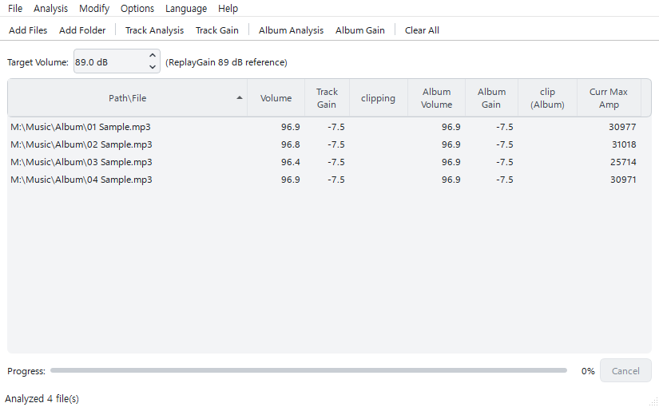
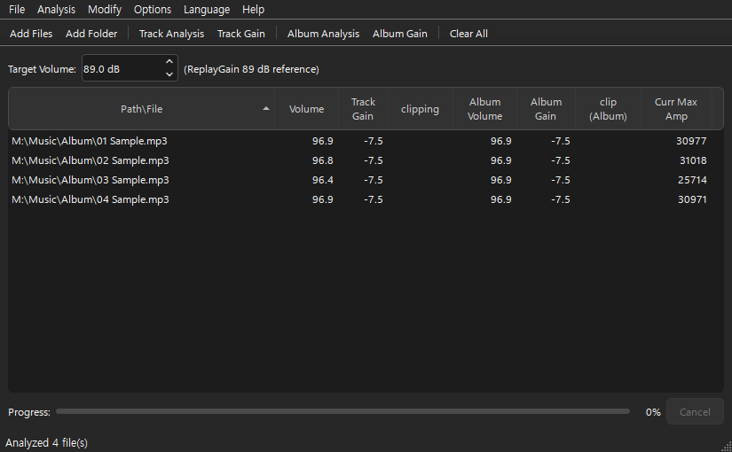

<p align="center">
  <strong>Language:</strong>
  <a href="README.md">English</a> |
  <a href="README.ko.md">한국어</a> |
  <a href="README.zh-CN.md">简体中文</a> |
  <a href="README.ja.md">日本語</a> |
  <a href="README.es.md">Español</a> |
  <a href="README.ru.md">Русский</a>
</p>

> 本文档由 AI 从英文版翻译而来。如有出入，以英文版为准。

# Gain dB

<p align="center">
  <a href="https://github.com/metapbl/GainDB/releases"></a>
  <a href="LICENSE"></a>
  <a href="#系统要求"></a>
  <a href="#安装"></a>
</p>

无需重新编码即可分析并统一 MP3 音量的命令行与图形界面工具。

## 功能

Gain dB 测量 MP3 文件听起来有多响，并在**不重新编码**的情况下把它们调整得一致，
因此不会损失音质。它是在阅读 mp3gain 源代码的基础上用 Python 重构而成的，
结果与 mp3gain 相同：相同的 dB 值、增益步数和标签。

- **无损增益调整。** 每个 MP3 帧都有一个 8 位的 `global_gain` 字段。将它改变
  N 步，声音会按 `2^(N/4)`（每步约 1.5 dB）缩放，不触及音频数据，并且可以撤销。
- **响度分析。** 用 ffmpeg 解码音频，再用 ReplayGain 算法测量，算出达到目标
  响度（默认 89 dB）所需的调整量。
- **Track 与 Album 模式。** Track 增益让每个文件各自一致。Album 增益对所有文件
  应用同一个调整，保留曲目之间的响度差异。
- **标签。** 在 APEv2（默认）或 ID3v2 中读取、写入和删除 ReplayGain 与 mp3gain
  标签，包括撤销信息。
- **CLI 与 GUI。** 一个使用 mp3gain 选项的命令行工具，以及适用于 Windows 和
  macOS 的 PySide6 GUI，支持深色和浅色主题、六种语言（English、한국어、
  简体中文、日本語、Español、Русский）以及原版 mp3gain GUI 的选项。

Gain dB 按设计**只处理 MP3 文件**：无损方法依赖 MP3 的 `global_gain` 字段，
其他格式没有这个字段。

## 截图

<table>
  <tr>
    <th>浅色</th>
    <th>深色</th>
  </tr>
  <tr>
    <td></td>
    <td></td>
  </tr>
</table>

对四个示例文件进行专辑分析后的界面：显示每个文件的音量以及 Track/Album 增益。

## 系统要求

- **ffmpeg 和 ffprobe** — 分析时需要。软件不附带它们，请自行安装（见下文）。
- **从源代码运行时：** Python 3.13 或更高版本。依赖包（numpy、PySide6）
  通过 `requirements.txt` 安装。

### 安装 ffmpeg

下载适用于你系统的版本，并确保 `ffmpeg` 和 `ffprobe` 都在 PATH 中：

- **Windows：** `winget install Gyan.FFmpeg`，或
  https://www.gyan.dev/ffmpeg/builds/ 的 "release essentials" 版本
- **macOS：** `brew install ffmpeg`，或 https://evermeet.cx/ffmpeg/ 的版本
- **Linux：** 使用包管理器（例如 `sudo apt install ffmpeg`），或
  https://johnvansickle.com/ffmpeg/ 的静态版本

Gain dB 先在 PATH 中查找。如果找不到，再按顺序检查下列文件夹，只使用同时包含
两个程序的文件夹：

- **Windows：** `%LOCALAPPDATA%\Microsoft\WinGet\Links`（winget）、
  `C:\ffmpeg\bin`、`%ProgramFiles%\ffmpeg\bin`
- **macOS：** `/opt/homebrew/bin`、`/usr/local/bin`（Homebrew；也适用于从 Finder
  启动、看不到 shell PATH 的应用）

## 安装

**Windows 应用：** 从 [Releases](https://github.com/metapbl/GainDB/releases)
下载 `GainDB-<版本>-windows.zip`，解压后运行 `GainDB` 文件夹中的 `GainDB.exe`。
不需要 Python。

**从源代码（Windows、macOS、Linux）：**

```
git clone https://github.com/metapbl/GainDB.git
cd GainDB
python -m venv .venv
.venv\Scripts\activate          # macOS / Linux: source .venv/bin/activate
pip install -r requirements.txt
```

这会在 `.venv` 中创建虚拟环境并把依赖包安装进去。

## 快速上手

打开 GUI（从源代码运行：`python -m gui`），添加文件或文件夹，然后依次选择
**分析 > 专辑分析** 和 **修改 > 专辑增益**。分析会填写 dB 列；增益步骤会修改
文件并保存撤销标签。

在命令行中，仅做分析不会修改文件：

```
python gaindb_cli.py song.mp3
```

```
song.mp3
Recommended "Track" dB change: -7.880000
Recommended "Track" mp3 gain change: -5
Max PCM sample at current gain: 30976.785156
Max mp3 global gain field: 210
Min mp3 global gain field: 158
```

数值因文件而异。增益调整 `-5` 表示文件将降低 5 步（约 7.5 dB）。

## 用法

### 命令行

```
python gaindb_cli.py [options] <infile> [<infile 2> ...]
```

常用选项（与 mp3gain 相同）：

- `-r` 应用 Track 增益，使所有文件响度一致
- `-a` 对所有文件应用同一个 Album 增益
- `-k` 按需降低 Track/Album 增益以避免削波
- `-s c` 只显示已保存的标签信息
- `-s d` 只删除已保存的标签信息
- `-s i` 将增益信息保存到 ID3v2 标签（默认为 APEv2）
- `-u` 使用已保存的标签信息撤销之前的修改
- `-o` 输出以制表符分隔、便于导入数据库的列表

`python gaindb_cli.py -h` 列出所有选项，
`python gaindb_cli.py -? wrap` 解释 `-w` wrap 选项。

```
# Apply Track gain to one file
python gaindb_cli.py -r song.mp3

# Apply Album gain to a folder's files, avoiding clipping
python gaindb_cli.py -a -k album/*.mp3

# Undo previous changes
python gaindb_cli.py -u song.mp3
```

每条命令会逐个文件输出它所做的修改。如果不放心，首次运行前请先备份文件。

### 图形界面

```
python -m gui
```

这会打开主窗口，其中有文件和文件夹列表、Track/Album 分析与增益、右键菜单、
取消、日志窗口和托盘图标。语言菜单和 选项 > 主题 会立即改变界面。选项菜单可以
保留文件日期、在 Track 增益中避免削波，以及总是重新计算而不读取已保存的标签。
修改 > 应用固定增益 会按固定步数改变文件；打开 选项 > 启用“最大化”功能 后，会出现
原版 mp3gain GUI 的无削波最大分析和增益。文件菜单可以选择所有文件、取消选择和反向选择，
语言 > 系统默认 会跟随操作系统的语言。

## 与 mp3gain 的关系

Gain dB 是对 mp3gain 源代码的 Python 重构。它保留了 mp3gain 的行为、命令行选项
以及文件和标签格式，使结果保持兼容。标签处理和无损增益写入模块改编自 mp3gain 的
C 源代码，后者以 GNU LGPL v2.1 或更高版本授权，Gain dB 整体也使用相同的许可证。
响度分析遵循公开的 ReplayGain 规范；其滤波器系数是多个独立实现共用的公开标准
数值。详情见 [NOTICE](NOTICE)。

## 项目状态

- 版本 1.x，正在实际使用。命令行选项遵循 mp3gain，预计不会改变。
- 每次 push 都会在 Windows、macOS 和 Ubuntu 上运行测试。在 macOS 和 Ubuntu 上
  还会将 dB 值、增益步数和标签与 mp3gain 对比。
- GUI 在 Windows 和 macOS 运行器上检查。发布版本只提供 Windows 版；在 macOS
  和 Linux 上请从源代码运行。GUI 尚未在 Linux 上试过。

## 帮助与贡献

- 提问和报告错误：[GitHub Issues](https://github.com/metapbl/GainDB/issues)。
- 欢迎 Pull request。较大的改动请先开 issue 讨论。贡献内容按
  LGPL-2.1-or-later 接收。
- 提交 Pull request 前，请运行完整测试（需要 ffmpeg）：

```
pip install -r requirements-dev.txt
python tests/_gen_fixtures.py
python -m unittest discover -s tests
```

第一条命令安装测试用依赖包（会加装 SciPy）；第二条生成测试用 MP3 文件；第三条运行所有测试。

## 安全

请通过 [GitHub 私密漏洞报告](https://github.com/metapbl/GainDB/security/advisories/new)
私下报告漏洞，不要发到公开 issue 中。

## 致谢

Gain dB 基于 Glen Sawyer 的 [mp3gain](https://sourceforge.net/projects/mp3gain/)。
ReplayGain 分析由 David Robinson 和 Glen Sawyer 编写，并由 Frank Klemm 和
Marcel Mueller 改进。本项目使用 [numpy](https://numpy.org/)、
[PySide6](https://doc.qt.io/qtforpython-6/)，
并将 [ffmpeg](https://ffmpeg.org/) 作为外部程序调用。

## 许可证

[LGPL-2.1-or-later](LICENSE)。mp3gain 版权声明见 [NOTICE](NOTICE)，依赖项许可证见
[THIRD_PARTY_LICENSES](THIRD_PARTY_LICENSES)。numpy 为 BSD-3-Clause；
PySide6（Qt for Python）为 LGPLv3。本软件不附带 ffmpeg；如果你随本软件分发
ffmpeg 版本，请使用 LGPL 版本并遵守其许可条款。
